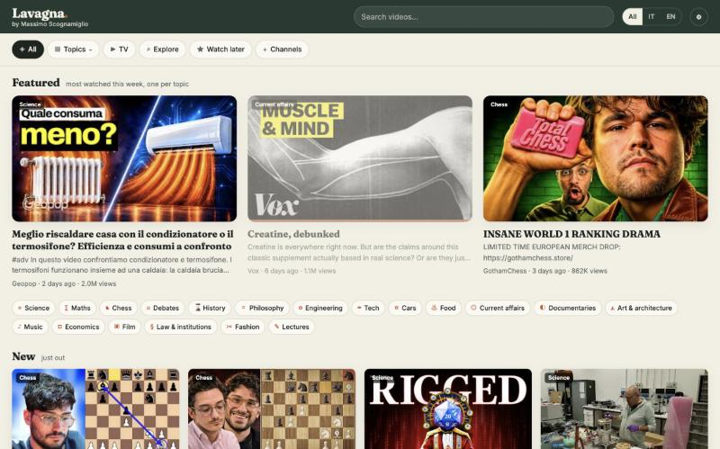
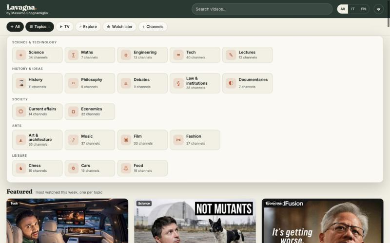
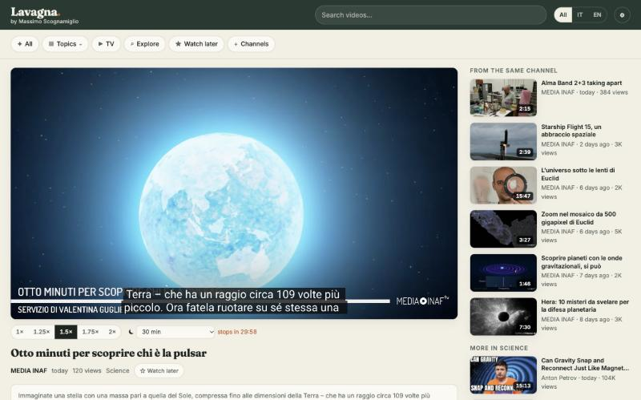
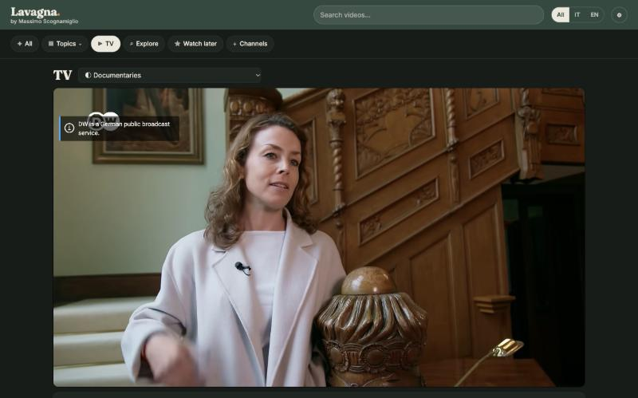

# Lavagna.

*by Massimo Scognamiglio*

## YouTube, curated. No ads.

**Lavagna is the best of YouTube for curious people — hand-picked, ad-free, and calm.**

No ads on the page. No Shorts. No algorithm pulling you down a rabbit hole. Just ~400 great channels about science, history, maths, philosophy, law, economics, art, music, film, fashion, chess and more — in English and Italian.

👉 **Try it: https://lavagna.lavagna-video.workers.dev**



## Why it's cool

- 🎯 **Curated, not recommended.** Every channel is picked by a person and checked: active, long-form videos, a real audience. No clickbait farms.
- 🚫 **No ads, no Shorts, no algorithm.** The page has zero ads and zero tracking. Shorts never show up. Nothing autoplays you into junk.
- 📺 **TV mode.** Pick a topic and let it play, one great video after another. Plus two live channels: Earth from the Space Station, and the strongest chess game being played right now.
- ⏩ **Your pace.** Every video plays at 1× to 2×, with a sleep timer ("stop at the end of this video") for evening watching.
- 🗂 **Topics, not a feed.** 19 topics in five groups — browse like a library, not a slot machine.
- 🌍 **English and Italian**, side by side, with a filter for video language. Interface in English or Italian.
- 🌙 **Light, dark or automatic** theme.
- 🏛 **More than YouTube.** Public-domain films from the Internet Archive, NASA footage, Vimeo documentaries, PeerTube.
- 🔎 **Search the whole archive** by words, topic, length and source — or just browse the most recent and most watched.
- 🔑 **Your own Lavagna.** Create an account in one tap with a passkey (Face ID, Touch ID, fingerprint — no email, no password) and add your own channels and topics on top of everyone's. Only you see them.
- 🌱 **It grows by itself.** Every few minutes it indexes new videos and older archives; it even suggests new channels worth adding — and can build a whole new topic on request.

## Coming next: search by meaning 🧠

The next feature to be released. Type *"how stars are born"* and Lavagna will also find the videos that never use those words — even in another language. It's being trained right now on every video in the library, a few dozen at a time.

| Browse by topic | Speed and sleep timer | TV mode, dark theme |
|---|---|---|
|  |  |  |

## Free, open, and cheap to run

Lavagna runs entirely on Cloudflare's free tier, and the code is open under the **MIT licence**: use it, copy it, change it, build your own curated video library.

---

## How it's built

Everything runs on Cloudflare's free tier:

| Piece | What it's for |
|---|---|
| **Workers** (`src/worker.js`) | API, feeds, curation, static assets |
| **D1** (`migrations/`) | the video index, FTS5 full-text search, counters |
| **Vectorize** + **Workers AI** (`@cf/baai/bge-m3`) | semantic search (coming next; the index is being built) |
| **Workers AI** (Mistral Small 3.1, Llama 3.3 70B fallback) | topic keywords and channel vetting |
| **KV** | channel and topic changes made from the site, passkey challenges |
| **Passkeys** ([SimpleWebAuthn](https://simplewebauthn.dev)) | optional accounts for «My Lavagna», no email or password |
| **Cron** (every 5 min) | refreshes feeds, fills the index, builds embeddings, reads YouTube archives |

Feeds come from public RSS (YouTube's long-videos-only uploads playlist, so Shorts never appear). An optional **YouTube Data API key** adds durations, view counts and each channel's full back catalogue, slowly and within quota.

The front end is plain HTML, CSS and JavaScript (`public/`), no framework and no build step.

A daily **write budget** keeps the database comfortably inside the free plan.

## Run it yourself

```bash
npm install
cp .dev.vars.example .dev.vars        # set your local admin password
npx wrangler d1 create lavagna        # put the id in wrangler.toml
npx wrangler vectorize create lavagna-significato --dimensions=1024 --metric=cosine
npx wrangler kv namespace create LAVAGNA   # put the id in wrangler.toml
npx wrangler d1 migrations apply lavagna --local
npm run dev                           # http://localhost:8797
```

To deploy: set `account_id` and the resource ids in `wrangler.toml` to your own, apply the migrations with `--remote`, then

```bash
npx wrangler secret put ADMIN_PASSWORD
npx wrangler secret put YT_KEY        # optional: YouTube Data API v3 key
npx wrangler deploy
```

The channel list lives in `src/canali.js` (id, name, language). A channel id also tells the source: `UC…` YouTube, `ia:collection` Internet Archive, `vimeo:channels/name` Vimeo, `pt:instance` PeerTube.

## A note on ads

The page itself has no ads and no tracking. Videos play in each platform's own player: some YouTube channels may still show ads inside the player (they disappear with YouTube Premium).

---

## In italiano

**Lavagna** è una videoteca per imparare, scelta a mano: canali ufficiali e archivi aperti, senza pubblicità nella pagina, senza Shorts e senza consigli automatici. Account facoltativo con passkey (niente email né password) per aggiungere i propri canali e argomenti. Interfaccia in inglese e in italiano (⚙ in alto a destra), tema chiaro, scuro o automatico. Ricerca per parole (e presto anche per significato), modalità TV con timer di spegnimento, velocità fino a 2× su ogni video, e strumenti per aggiungere canali e argomenti nuovi.
